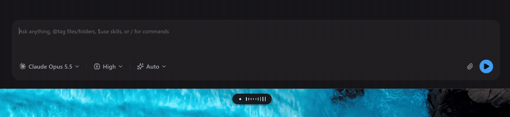

# Parla

Fast push-to-talk dictation for Windows. Hold **Ctrl+Alt**, talk, let go: the
transcript is pasted into whatever app has focus. Transcription runs in the
cloud (OpenAI or xAI Grok) while you speak, or fully on your machine with
NVIDIA's Parakeet model. Parla pastes exactly what you said and adds no LLM
rewrite step, so the time from letting go to the paste stays short.



## Install

**[Download the latest release](https://github.com/matdac12/parla/releases/latest)**
(Windows 10/11, x64), then run `Parla_<version>_x64-setup.exe`. It installs
for your user only, without an admin prompt, and adds Parla to the Start menu.
If you don't want an installer, use the portable `.zip`: extract it, keep the
folder together and run `parla.exe`.

Parla isn't code-signed yet, so Windows SmartScreen will say *"Windows
protected your PC"*. Click **More info → Run anyway**. Every release includes
a `SHA256SUMS.txt` to check your download against.

### Or let your AI agent install it

Paste this into Claude Code, Codex or any agent with a Windows terminal:

```text
Install Parla (https://github.com/matdac12/parla), a Windows dictation app, on this PC.
Download the latest Parla_*_x64-setup.exe from the GitHub release at
https://github.com/matdac12/parla/releases/latest, verify it against that release's
SHA256SUMS.txt, run it with /S for a silent per-user install, then start Parla from its
Start menu shortcut. It lives in the system tray and opens a short setup guide on its first
launch. Walk me through it: ask whether I want cloud transcription (an OpenAI or xAI API key)
or local (the Parakeet model, about 640 MB), and tell me the hotkeys from the README.
```

## First run

1. The first time Parla starts, a short **setup guide** opens: your microphone, the
   engine (paste an **OpenAI** or **xAI** API key, or choose **Local** and download the
   Parakeet model, about 640 MB, once; after that it needs no network or key), a test
   dictation, and whether Parla starts with Windows. Every step can be skipped.
2. After that Parla lives in the **system tray**. Click its icon for quick switches, or
   right-click it for **Settings…**. **Settings → Dictation & hotkey → Run setup again**
   reopens the guide.
3. Click into any text field, hold **Ctrl+Alt**, speak, release.

| Shortcut | What it does |
| --- | --- |
| Hold **Ctrl+Alt** | Record while held, paste on release |
| Tap **Ctrl+Alt+Space** | Hands-free: record until you press **Ctrl+Alt** again |
| **Esc** | Cancel the recording, or the paste that's about to happen |

You can change the hotkeys in Settings. WebView2 is required; it's preinstalled
on Windows 11, and the installer fetches it on Windows 10 if it's missing.

## What's inside

- **Live captions.** With cloud providers, a small preview shows the words as
  you speak. The final transcript is pasted once you stop.
- **Local model.** Parakeet v3 or Parakeet Ultra runs on your CPU, phrase by
  phrase at your pauses, in 25 languages.
- **A pill, not a window.** A small pill on screen shows the live level meter,
  a spinner while transcribing, then a check.
- **Your own latency numbers.** Each dictation saves per-stage timings to a local
  history, and a built-in benchmark compares providers on your voice and your network.
- **Recognition hints.** A vocabulary list of names and jargon is passed to the
  providers as hints.
- **Command mode (experimental, off by default).** A separate hotkey sends
  spoken instructions to an LLM. Dictation never goes through it.

API keys are stored in plain text in
`%APPDATA%\com.matdac6.parla\settings.json`. Audio goes only to the provider
you pick; with Parakeet, nothing leaves your machine.

## Documentation

- [User guide](docs/guide.md): every setting, the providers, the local
  model, history, benchmark, troubleshooting and known limitations.
- [Development](docs/development.md): building from source, tests, CI and
  releasing.
- [Design spec](docs/superpowers/specs/2026-10-14-parla-design.md) and
  [architecture decisions](docs/adr/).

## Build from source

You need Rust (MSVC toolchain), the Visual Studio C++ Build Tools and Node.js;
see [prerequisites](docs/development.md#windows-prerequisites).

```powershell
git clone https://github.com/matdac12/parla
cd parla
npm ci
npm run tauri dev
```

Or hand it to your agent:

```text
Clone https://github.com/matdac12/parla, read its AGENTS.md and docs/development.md,
install any missing prerequisites (Rust MSVC toolchain, Visual Studio C++ Build Tools,
Node.js LTS), then build it with `npm ci` and `npx tauri build --no-bundle` and start
src-tauri\target\release\parla.exe.
```

## License

[MIT](LICENSE). Third-party components and model licenses are listed in
[THIRD_PARTY_NOTICES.md](THIRD_PARTY_NOTICES.md).
